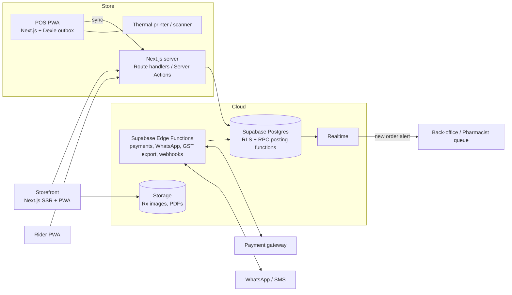

# CTO — Architecture & Technology Decisions

Owner: `cto` · Reviewed by: `engineering-manager`, `security-privacy`

## 1. Stack (Nov 2026)
| Layer | Choice | Why |
|---|---|---|
| Monorepo | Turborepo + pnpm workspaces | Shared domain logic between POS, back-office, storefront |
| Web apps | **Next.js 16** (App Router, Turbopack, React 19, Server Actions) | One framework for back-office, POS PWA and SEO storefront |
| UI | Tailwind CSS v4 + shadcn/ui (Radix) + lucide icons | Accessible primitives, fast to build, themeable |
| Client state/data | TanStack Query, Zustand (POS cart) | Cache + optimistic UI |
| Offline POS | Service worker + **Dexie (IndexedDB)** outbox | Bill without internet; idempotent sync |
| Domain logic | `packages/core` pure TypeScript (GST, FEFO, units, schedule rules, numbering) | Same code in browser, server, tests |
| Validation | Zod (shared contracts) | One schema for UI, API, DB RPC input |
| Database | **Supabase Postgres 17** | RLS for multi-tenancy, SQL for accounting, Realtime for online orders |
| Server logic | Postgres functions (atomic posting) + Supabase **Edge Functions** (Deno) for integrations | Transactions where data lives; integrations isolated |
| Auth | Supabase Auth (email/password + phone OTP for customers), MFA TOTP for admins | |
| Files | Supabase Storage (private buckets, signed URLs) for prescriptions, invoices | |
| Typed SQL in server | Drizzle ORM + `supabase gen types` | |
| Payments | Razorpay / Cashfree (UPI intent, cards), static & dynamic UPI QR at counter | |
| Messaging | WhatsApp Business Cloud API, SMS (DLT-registered templates) | |
| Hosting | Vercel (apps), Supabase ap-south-1 Mumbai (data residency) | |
| Observability | Sentry, PostHog (no PHI), Supabase logs, uptime checks | |
| Testing | Vitest, Playwright, pgTAP for RLS | |
| Desktop add-on (R2) | Tauri shell for ESC/POS printing, cash drawer, weighing/scanner without browser limits | |

## 2. High-level architecture

## 3. Key ADRs
- **ADR-001 Multi-tenancy**: shared schema, `org_id` on every row, RLS via `is_member(org_id)`; store-level via `has_store_access(store_id)`. Reason: cheapest to operate; Supabase-native.
- **ADR-002 Posting in Postgres**: `post_sale`, `post_purchase`, `post_return`, `post_online_order_invoice` are SQL functions that, in one transaction, allocate batches, write stock ledger, write compliance register rows, write journal lines and assign invoice number. Clients cannot insert into these tables directly.
- **ADR-003 Offline-first POS**: client generates `bill_uuid`; bill saved to Dexie outbox with provisional number `OFF-<device>-<seq>`; sync calls `post_sale(payload)` which is idempotent on `bill_uuid`. Server assigns final gap-free number; reprint shows both. Conflicts (batch sold out meanwhile) → server allocates next FEFO batch and flags the bill for review; never rejects a completed sale.
- **ADR-004 Money**: integer paise everywhere — `bigint` in DB, `number` (safe integer) in `packages/core`; no floats, no rupee decimals in storage.
- **ADR-005 Tax as data**: `tax_rates(hsn_prefix, rate, effective_from, effective_to)`; product stores HSN; rate resolved at bill date.
- **ADR-006 Append-only ledgers**: `stock_ledger`, `journal_lines`, `schedule_register`, `audit_log` have no UPDATE/DELETE grants; corrections are reversals.
- **ADR-007 Sensitive data**: Rx images in private bucket `prescriptions/{org_id}/…`; access via 5-min signed URLs logged in `audit_log`.
- **ADR-008 No microservices** until > 5k active stores or a team > 25 engineers.

## 4. Scale assumptions
10k stores × 300 bills/day = 3M bills/day peak future. Partition `sales_bill_lines`, `stock_ledger`, `journal_lines` by month when > 100M rows; read replicas for reports.

## 5. Top technical risks
| Risk | Mitigation |
|---|---|
| Offline duplicate/oversell | Idempotent RPC, server re-allocation, review flag |
| Printer/scanner compatibility | Browser print first; Tauri bridge R2; certified hardware list |
| GST/regulatory change | Rates and register templates as data; SME quarterly review |
| Data migration quality | Import validators, dry-run reports |
| RLS mistakes → data leak | pgTAP tests in CI for every table; security review gate |
