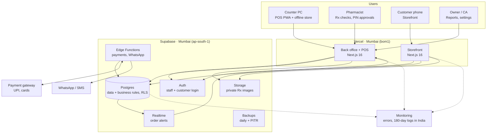

# Production & UAT Readiness — First Pilot Pharmacy

Owners: `cto` (architecture, environments), `security-privacy` (CSO), `devops-engineer`, `customer-success`, `qa-lead`
Status: draft v1 · 18-Nov-2026 · Track items with ☐ / ☑

> The CTO and CSO reviews below were written by Claude, following the `cto` and `security-privacy` agent briefs. Run those agents in Claude Code for an independent second review before sign-off.

## 1. Production architecture

**How a bill moves:**
1. The counter PC runs the POS in Chrome and keeps a copy of the catalogue, plus any unsent bills, in the browser (IndexedDB).
2. When online, each bill goes to `post_sale` in Postgres, which checks the rules and updates stock, the H1/X/narcotics registers, the accounts and the invoice number in one transaction.
3. When offline, bills print with provisional numbers and sync when the connection returns. A synced bill is never posted twice.
4. New online orders reach the store through Realtime. Payment and WhatsApp keys live only in Edge Functions, never in a browser.

**Data residency:** all compute and data are in Mumbai. Vercel Functions default to Washington (`iad1`), so the region **must** be pinned to `bom1`.

## 2. Rollout plan

| Phase | When | Activities | Owner |
|---|---|---|---|
| 0 · Production setup | T-14 days | Three Supabase projects (dev, staging, prod) on Pro in ap-south-1. Vercel Pro with functions pinned to `bom1`. Custom domains (`app.`, `shop.`). Database changes deploy only through CI (`supabase db push`). Secrets set per environment. | devops-engineer, cto |
| 1 · Onboard the pilot store | T-7 days | Import product master, opening stock (batch/expiry), licences, doctors. Register pharmacists with PINs. Invite staff. Install the POS as an app on the counter PC. Test printer and barcode scanner. 30-minute training in English/Hindi. | customer-success |
| 2 · Parallel run (UAT) | 2 weeks | Bill in both the old software and MedStar. Daily checks: cash count against the shift report, stock spot-check, H1 register. Bugs triaged daily. Online orders stay off. | qa-lead, product-manager |
| 3 · Go-live | After sign-off | Exit criteria: no S1 bugs, fewer than 5 S2 bugs, daily closing matches the cash count, SME sign-off on the registers. | qa-lead, pharmacy-sme, accounting-sme |

## 3. Giving users access

1. **Owner:** public sign-up is closed during UAT. We send the owner's invite; they set a password and turn on two-factor (TOTP) login.
2. **Staff:** the owner invites each person from Settings → Team with a role, store access and discount limit. The link only works for the invited email and expires in 7 days.
3. **Pharmacists:** the owner registers each pharmacist with their council registration number and a 4–6 digit PIN. Each shift, the pharmacist starts duty on the POS with the PIN.
4. **Customers:** the storefront opens after UAT is stable, with mobile OTP login and DPDP consent.

## 4. CTO review — readiness checklist

**Blockers (must be done before UAT)**
- ☐ Sprint 2: product master and CSV import, goods receipt (GRN) screen, opening stock import, customers and doctors, credit sales
- ☐ Offline app shell: a service worker so the POS opens with no internet. Today, bills are stored offline but the app won't load if Chrome is reopened during an outage.
- ☐ Silent printing on the counter PC (Chrome `--kiosk-printing`) and a certified printer/scanner list
- ☐ Edge Function to email/WhatsApp invite links (today owners copy the link by hand)

**Environment and operations**
- ☐ Separate dev, staging and prod Supabase projects. Prod is changed only by CI.
- ☐ Vercel function region set to `bom1`
- ☐ PITR switched on from day 1 of UAT. Pro includes daily backups; PITR costs $100/month per 7 days of retention and gives a worst-case recovery point of about 2 minutes.
- ☐ Restore drill in staging before go-live (target recovery point 15 min, recovery time 4 h)
- ☐ Billing alerts set up. Supabase's default spend cap does not cover compute or hourly add-ons such as PITR.
- ☐ Sentry error tracking and an uptime check on the app and the database API

**Cost:** Supabase Pro at $25/month base, plus compute, PITR ($100) and a log drain ($60), plus Vercel Pro. Re-check prices on the vendor pages at setup.

**Accepted for the pilot:** a single region and a single production database. Scaling work waits for real load data.

## 5. CSO review — security and compliance checklist

**Indian regulatory**
- ☐ CERT-In: report cyber incidents within **6 hours**. Name a 24×7 contact and a backup; write the incident procedure.
- ☐ CERT-In: keep logs **in India for 180 days**. Set up a Supabase log drain into storage hosted in India; Supabase's built-in log retention is too short.
- ☐ DPDP Act 2023 / Rules 2025: privacy notice at the counter (QR) and on the storefront, consent records, named grievance officer.
- ☐ Data Processing Agreement with the pilot pharmacy (the pharmacy is the fiduciary, MedStar the processor). Sign processing agreements with Supabase and Vercel.

**Login and access**
- ☐ Email confirmation on; our own email (SMTP) provider (Supabase's built-in email is not for production); public sign-up closed during UAT
- ☐ Two-factor login required for owner and admin roles; leaked-password protection and rate limits enabled
- ☐ The service-role key exists only in Edge Function secrets; key rotation documented
- ☐ GitHub branch protection: every change needs a review and passing CI

**Application**
- ☐ RLS cross-tenant tests pass in CI against staging (they pass locally today)
- ☐ Supabase security and performance advisor checks are clean
- ☐ OWASP ZAP baseline scan and a short external pen test before go-live
- ☐ Prescription images reachable only through short-lived signed URLs, with every view logged

**Counter PC**
- ☐ BitLocker disk encryption. Offline bills can hold a Schedule X prescription image in the browser until they sync (it is removed after upload).
- ☐ One Windows login per staff member, auto-lock, OS updates on

**Accepted risk (R2 fix):** staff could share a pharmacist's PIN. In R2, each pharmacist signs in with their own account and approves with it.

## 6. Go / no-go sign-off

| Area | Sign-off by | Status |
|---|---|---|
| Architecture & environments | cto | ☐ |
| Security & privacy | security-privacy (CSO) | ☐ |
| Drug-law compliance (registers, Rx rules) | pharmacy-sme | ☐ |
| GST & accounting | accounting-sme | ☐ |
| Test exit criteria | qa-lead | ☐ |
| Store onboarded & trained | customer-success | ☐ |
| Business go-ahead | product-manager / founder | ☐ |

## Sources
- Supabase pricing (PITR, plans): https://supabase.com/docs/pricing
- Supabase backups & PITR recovery point: https://vallettasoftware.com/blog/post/supabase-backup-restore
- Supabase spend cap & add-ons: https://www.usagepricing.com/blueprint/supabase
- Vercel regions (bom1, default iad1): https://vercel.com/docs/regions
- CERT-In 6-hour reporting & 180-day logs: https://www.mondaq.com/india/it-and-internet/1202576/everything-you-need-to-know-about-indias-new-guidelines-related-to-cyber-incident-reporting-by-cert-in
